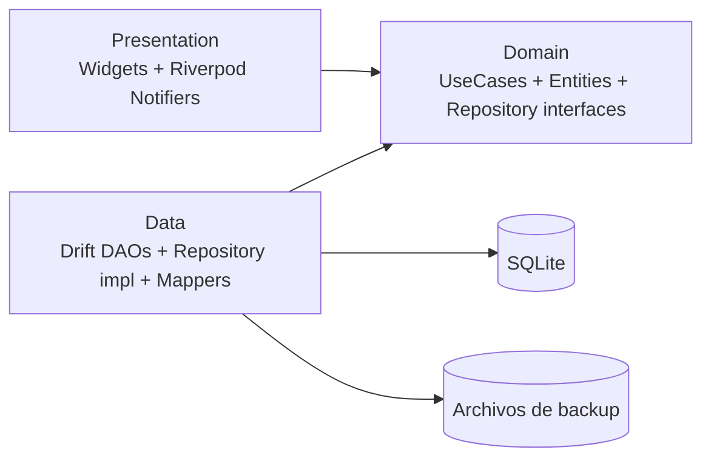

# 03 — Arquitectura

## Estilo
**Clean Architecture, feature-first**, con dependencias que apuntan siempre hacia el dominio.



- **Domain:** Dart puro. Entidades inmutables, interfaces de repositorio, casos de uso. Sin imports de Flutter, Drift ni plugins.
- **Data:** implementaciones de repositorios, DAOs de Drift, mapeadores entidad↔tabla, servicios de backup/actualización.
- **Presentation:** pantallas, widgets, notifiers/providers. Solo llama casos de uso, nunca DAOs.

## Estructura de carpetas
```
lib/
├── main.dart
├── app/                    # MaterialApp, router, tema, localización
├── core/
│   ├── money/              # Money, Currency, formateo
│   ├── result/             # Result<T, Failure>
│   ├── errors/             # Failure
│   ├── utils/
│   └── widgets/            # componentes UI compartidos
├── l10n/                   # app_es.arb, app_en.arb
└── features/
    ├── accounts/
    ├── transactions/
    ├── categories/
    ├── debts/
    ├── receivables/        # préstamos por cobrar
    ├── savings/
    ├── budget/             # ingreso base y reparto
    ├── reports/
    ├── backup/
    ├── updates/
    ├── settings/
    └── quick_add/          # entrada desde widgets
        ├── domain/  (entities, repositories, usecases)
        ├── data/    (datasources, models, repositories)
        └── presentation/ (pages, widgets, providers)
android/app/src/main/kotlin/  # AppWidgetProviders nativos
test/                          # espejo de lib/
docs/                          # estos .md
```

## Stack
| Necesidad | Paquete | Nota |
|-----------|---------|------|
| Base de datos | `drift`, `drift_dev`, `sqlite3_flutter_libs` | Consultas tipadas, migraciones, agregaciones SQL |
| Estado + DI | `flutter_riverpod`, `riverpod_annotation` | |
| Navegación | `go_router` | Deep links para widgets |
| Modelos | `freezed`, `json_serializable` | Entidades inmutables y JSON del backup |
| i18n | `flutter_localizations`, `intl` | ARB es/en |
| Gráficas | `fl_chart` | |
| Widgets del home | `home_widget` + Kotlin nativo | |
| Archivos | `file_picker`, `path_provider`, `share_plus` | Carpeta de backup (SAF) |
| Tareas en segundo plano | `workmanager` | Backup automático |
| Actualizaciones | `package_info_plus`, `http`, `dio`, `open_filex` | GitHub Releases |
| Preferencias | `shared_preferences` | Tema, idioma, moneda |
| Pruebas | `flutter_test`, `mocktail` | |
| Lint | `very_good_analysis` o `flutter_lints` estricto | |

Usar la última versión estable de cada paquete y verificarla en pub.dev al iniciar.

## Flujo de datos
`Widget → Notifier → UseCase → Repository (interface) → RepositoryImpl → DAO → SQLite`

Las lecturas usan `Stream` de Drift para que la UI se actualice sola.

## Manejo de errores
Los casos de uso devuelven `Result<T, Failure>`; la UI muestra mensajes localizados. No se lanzan excepciones a la capa de presentación.

## Inyección de dependencias
Providers de Riverpod en la raíz de cada feature; las interfaces de repositorio se sobrescriben en tests.
