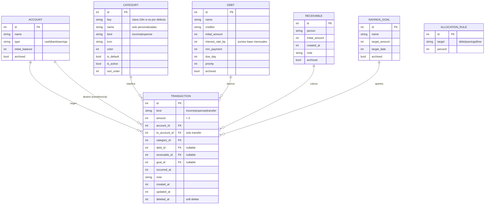

# 04 — Modelo de datos

Base de datos SQLite local con Drift. **Todos los montos son `INTEGER` en unidad menor** (COP: pesos; USD/EUR: centavos). Los saldos **se calculan** a partir de transacciones; no se almacenan.

## Tablas auxiliares
- `app_settings` (clave/valor) para: `base_income`, `debt_strategy`, `schema_version`.
- `reminders`: `id`, `title`, `due_at`, `repeat_rule`, `done`.
- Tema, idioma, moneda: `shared_preferences`.

## Reglas de integridad
1. `amount > 0` siempre; el signo lo da `kind`.
2. `transfer` exige `to_account_id ≠ account_id` y no lleva categoría.
3. `debt_id` solo en gastos; `receivable_id` solo en ingresos.
4. Saldo de cuenta = `initial_balance + Σ ingresos − Σ gastos ± transferencias` (excluye `deleted_at != null`).
5. Saldo de deuda = `initial_amount − Σ abonos`; saldo por cobrar = `initial_amount − Σ cobros`. Nunca negativo.
6. Las categorías con transacciones **no se eliminan**: se inhabilitan.
7. Eliminación lógica en transacciones; purga opcional manual.
8. Índices: `transactions(occurred_at)`, `(category_id)`, `(account_id)`, `(debt_id)`, `(receivable_id)`.

## Categorías por defecto (claves i18n)
- **Gasto:** `food`, `drinks`, `outings`, `partner`, `hygiene`, `transport`, `fuel`, `moto_maintenance`, `moto_documents`, `debt_payment`, `savings_contribution`, `health`, `education`, `other_expense`.
- **Ingreso:** `salary`, `drinks_business`, `deliveries`, `moto_rental`, `family_support`, `external_services`, `loan_collection`, `other_income`.

Se cargan en la primera migración con `is_default = true`. El usuario puede inhabilitarlas (`is_active = false`) pero no borrarlas.

## Migraciones
Cada cambio de esquema incrementa `schemaVersion` con una migración escrita y una prueba que parte de la versión anterior con datos reales.
