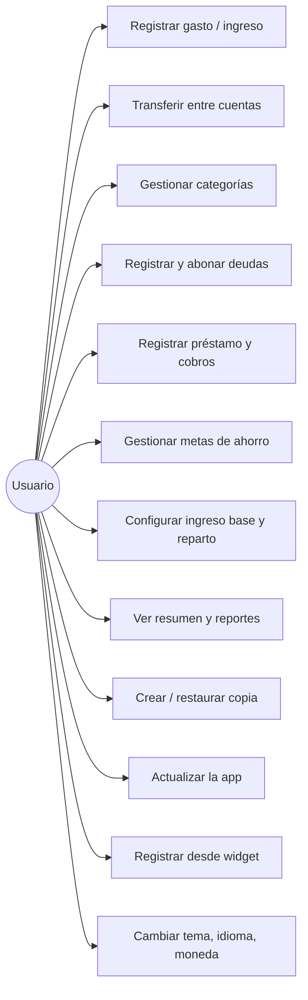
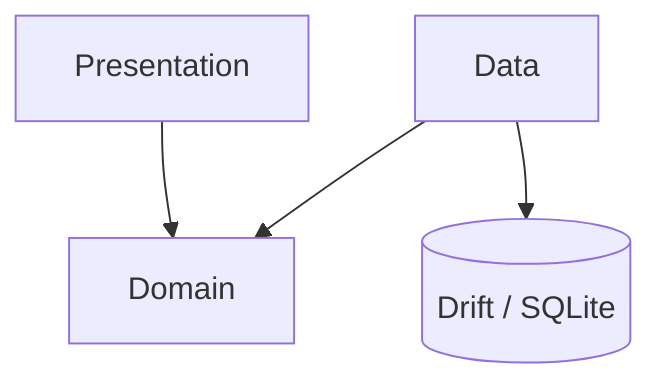
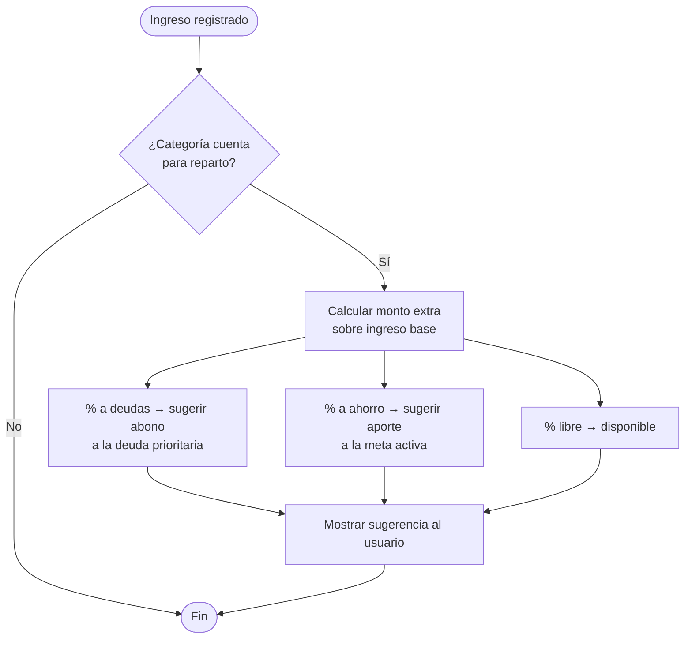
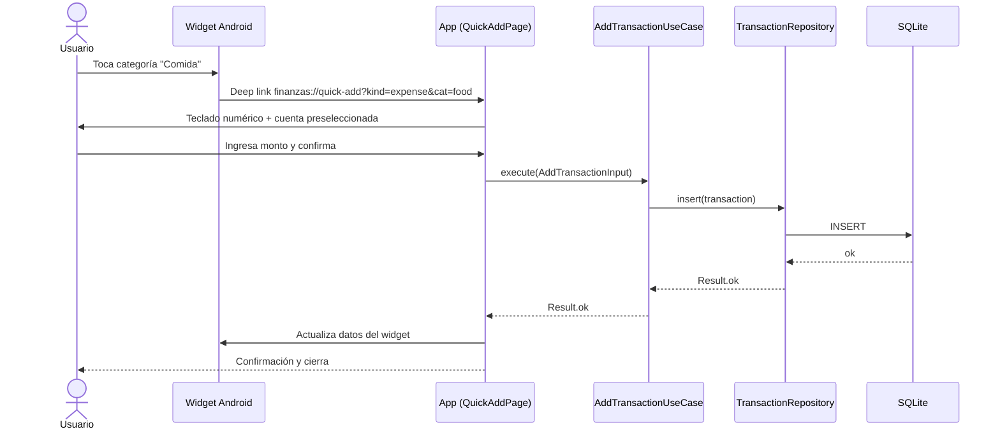
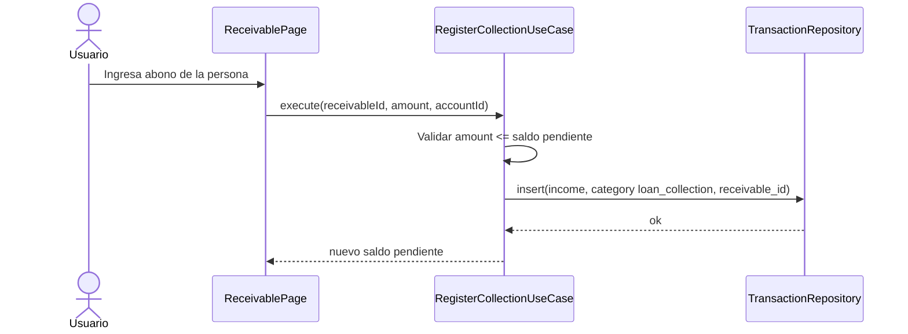
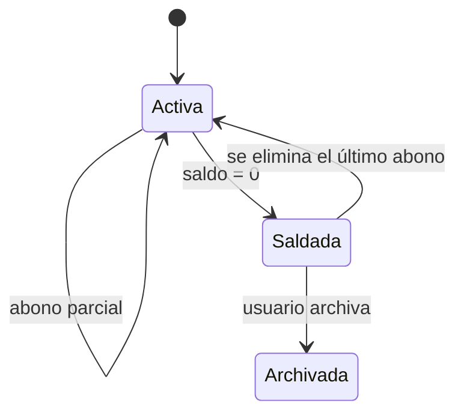
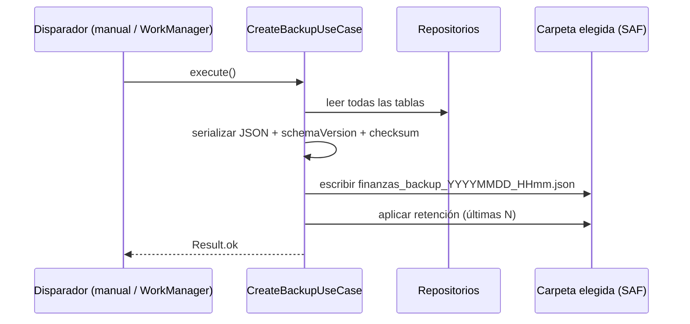
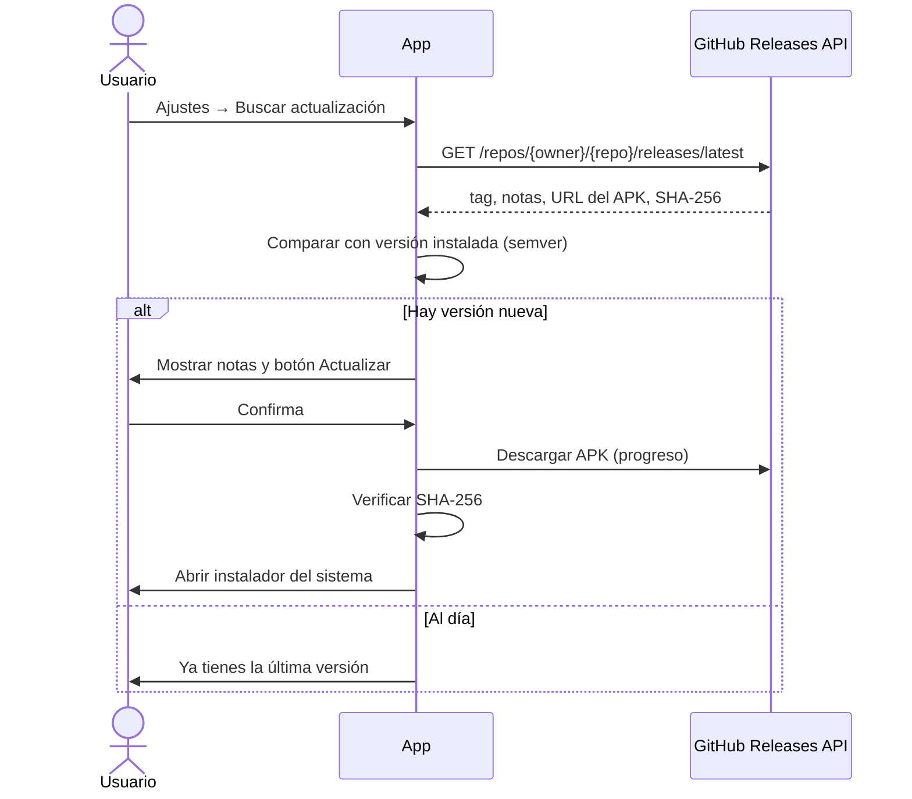

# 05 — Diagramas

## Casos de uso

## Capas y dependencias

## Reparto de un ingreso extra

La app **sugiere**; el usuario confirma cada movimiento.

## Secuencia: gasto desde el widget

## Secuencia: abono de préstamo por cobrar

## Estados de una deuda / préstamo

## Secuencia: copia de seguridad

## Secuencia: actualización dentro de la app

